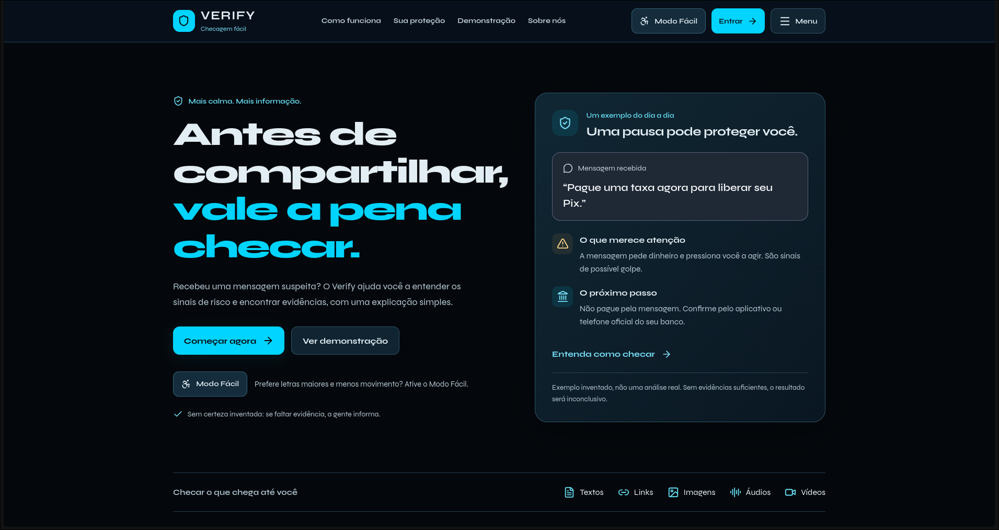
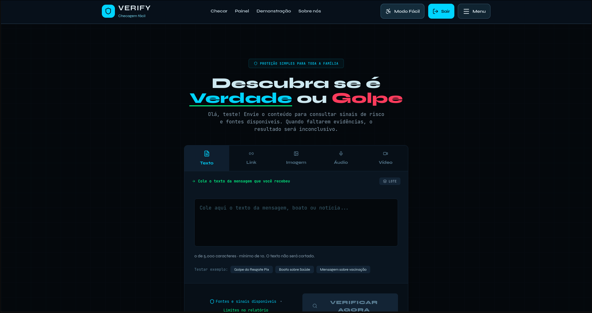
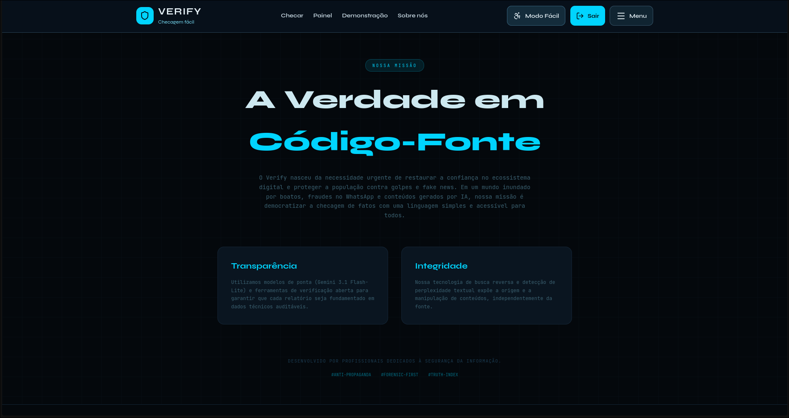

# Verify

> Sistema para verificação de notícias

---

## 📌 Informações Gerais

- **Nome do Projeto:** Verify
- **Equipe:** Juan Oliveira, Robert Rodrigues, Luan Rodrigues, Mayara Hillary, Ana Luiza, Arthur Henrique, Isabella Rodrigues
- **Curso:** Técnico em Informática
- **Instituição:** Funec Riacho
- **Ano/Semestre:** 1°, 2° e 3°
- **Professor Orientador:** Rúbens
- **Cliente/Setor Solicitante:** (Ex: Secretaria, Biblioteca, Coordenação)

---

## 🎯 Objetivo do Projeto

Desenvolver um sistema web para fazer uma analisar a veracidade de uma notícia, usando geração de relatórios e cruzamento de dados.

---

## 👥 Público-Alvo

- Idosos que não sabem como efetivamente fazer pesquisas acerca de uma notícia
- Canais de notícia
- Público em geral

---

## 🧩 Problema a Ser Resolvido

Muitas pessoas tem dificuldade em pesquisar acerca de um boato ou notícia para descobrir sua veracidade. Consequentemente, a propagação de fake news é impulsionada.

---

## 💡 Solução Proposta

Um sistema web integrado com IA: pesquisa sobre a notícia enviada pelo usuário e gera um relatório com todas as evidências e fontes dessa notícia. 

---

## ⚙️ Funcionalidades do Sistema

### Funcionalidades Principais

- [ x ] Cadastro de usuários
- [ x ] Login no sistema
- [ ] Cadastro de itens (ex: livros, equipamentos, etc.)
- [ ] Edição de dados
- [ ] Exclusão de registros
- [ x ] Pesquisa/Busca
- [ x ] Relatórios
- [ ] Controle de acesso por perfil

---

## 🛠️ Tecnologias Utilizadas

- Linguagem: Python, Javascript, HTML e CSS
- Framework: React, FastAPI
- Banco de Dados: Postgres
- Ferramentas: Docker, Vercel
- Versionamento: Git e GitHub

---

## 🗂️ Estrutura do Projeto

/projeto
│
├── backend
│   ├── app
│   │   ├── api
│   │   ├── core
│   │   ├── models
│   │   └── services
│   ├── tests
│   ├── scripts
│   └── requirements.txt
│
├── frontend
│   ├── src
│   │   ├── components
│   │   ├── hooks
│   │   ├── services
│   │   └── pages
│   └── package.json
│
│
├── docs
│   ├── general.md
│   ├── DOCUMENTACAO-COMPLETA.md
│   └── README.md
│
├── Dockerfile
├── docker-compose.yml
├── README.md
└── railway.toml

———

## 🧪 Requisitos Funcionais

- RF01 – O sistema deve permitir cadastrar usuários.
- RF02 – O sistema deve permitir realizar login e logout.
- RF03 – O sistema deve permitir renovar a sessão do usuário com segurança.
- RF04 – O sistema deve permitir consultar os dados da conta autenticada.
- RF05 – O sistema deve permitir enviar textos para verificação.
- RF06 – O sistema deve permitir verificar links de páginas públicas.
- RF07 – O sistema deve permitir enviar imagens, áudios e vídeos para análise.
- RF08 – O sistema deve identificar possíveis sinais de desinformação, conteúdo gerado por IA e fraude digital.
- RF09 – O sistema deve apresentar relatório com veredito, evidências, fontes e limitações.
- RF10 – O sistema deve permitir consultar o histórico de verificações do usuário.
- RF11 – O sistema deve permitir filtrar o histórico por tipo de conteúdo e resultado.
- RF12 – O sistema deve permitir exportar relatórios compatíveis em formato PDF.
- RF13 – O sistema deve controlar cotas diárias conforme o plano do usuário.
- RF14 – O sistema deve informar quando uma análise for inconclusiva ou não possuir cobertura suficiente.
- RF15 – O sistema deve permitir revisar o texto extraído de imagens, áudios e vídeos antes de realizar nova verificação.

> Observação: edição e exclusão completa de contas ainda não são funcionalidades garantidas pelo sistema.

———

## 🚫 Requisitos Não Funcionais

- RNF01 – O sistema deve ser acessível por navegadores modernos.
- RNF02 – O sistema deve possuir interface simples, intuitiva e responsiva.
- RNF03 – O sistema deve funcionar em computadores da escola com conexão à internet.
- RNF04 – O sistema deve proteger autenticação e sessão usando cookies HTTP-only e JWT.
- RNF05 – O sistema deve restringir o histórico ao usuário proprietário.
- RNF06 – O sistema não deve expor senhas, tokens ou credenciais nos logs e respostas da API.
- RNF07 – O sistema deve validar tamanho, formato e conteúdo de arquivos enviados.
- RNF08 – O sistema deve limitar requisições, concorrência e consumo diário por usuário.
- RNF09 – O sistema deve informar claramente limitações, falhas de fornecedores e resultados inconclusivos.
- RNF10 – O sistema deve preservar a privacidade dos textos, mídias e resultados analisados.
- RNF11 – O sistema deve permitir execução local por Docker Compose.
- RNF12 – O sistema deve manter tempo de resposta adequado para uso educacional.
- RNF13 – O sistema deve funcionar mesmo quando serviços externos de análise estiverem indisponíveis, apresentando o resultado como inconclusivo
---

## 📅 Cronograma do Projeto

| Etapa | Descrição | Responsável | Data |
|------|-----------|-------------|------|
| 1 | Levantamento de requisitos | Equipe | 03/2026|
| 2 | Modelagem do sistema | Equipe | 03/2026|
| 3 | Desenvolvimento | Equipe | 06/2026|
| 4 | Testes | Equipe | 11/2026|
| 5 | Entrega | Equipe | 11/2026|

---

## 🧑‍💻 Integrantes da Equipe

| Nome | Função | Responsabilidade |
|------|-------|-----------------|
| Luan | Líder | Administrar a equipe e fazer apresentações |
| Juan | Desenvolvedor | Full Stack |
| Robert | Desenvolvedor | Full Stack |
| Ana | Designer | Cuidar da identidade visual do projeto |
| Arthur | Testador | Testar funcionalidades do software|
| Isabella | Documentação | Documentar o desenvolvimento do projeto |
| Mayara Hillary | Documentação | Documentar o desenvolvimento do projeto |

---

## 📷 Protótipos / Telas





---

## 📦 Como Executar o Projeto

### Pré-requisitos

1. Ter Git e Docker com Docker Compose instalados.
2. Garantir que as portas `5174`, `8001` e `5433` estejam disponíveis.

### Execução com Docker Compose

1. Clonar o repositório:

   ```bash
   git clone <url-do-repositorio>
   cd verify
   ```

2. Criar o arquivo de variáveis do backend:

   ```bash
   cp backend/.env.example backend/.env
   ```

3. Editar `backend/.env` e configurar, no mínimo, a origem do frontend:

   ```env
   CORS_ORIGINS=http://localhost:5174
   ```

   Chaves de serviços externos são opcionais para iniciar o projeto. Sem elas, recursos que dependem desses serviços podem retornar resultado inconclusivo.

4. Construir as imagens e iniciar os serviços:

   ```bash
   docker compose up --build
   ```

5. Acessar o sistema no navegador:

   - Frontend: <http://localhost:5174>
   - API: <http://localhost:8001>
   - Health check: <http://localhost:8001/health>

6. Para iniciar em segundo plano:

   ```bash
   docker compose up --build -d
   docker compose ps
   ```

7. Para consultar os logs do backend:

   ```bash
   docker compose logs --tail=100 backend
   ```

8. Para parar os serviços sem apagar os dados do banco:

   ```bash
   docker compose down
   ```

> O comando `docker compose up --build` já instala as dependências do frontend e do backend nas imagens. Não é necessário executar `npm install` no computador quando o projeto for rodado dessa forma.
